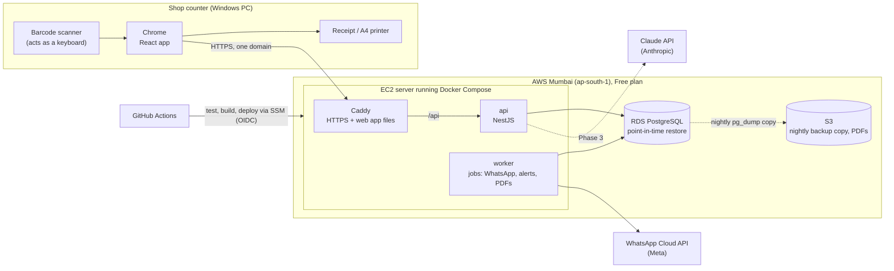
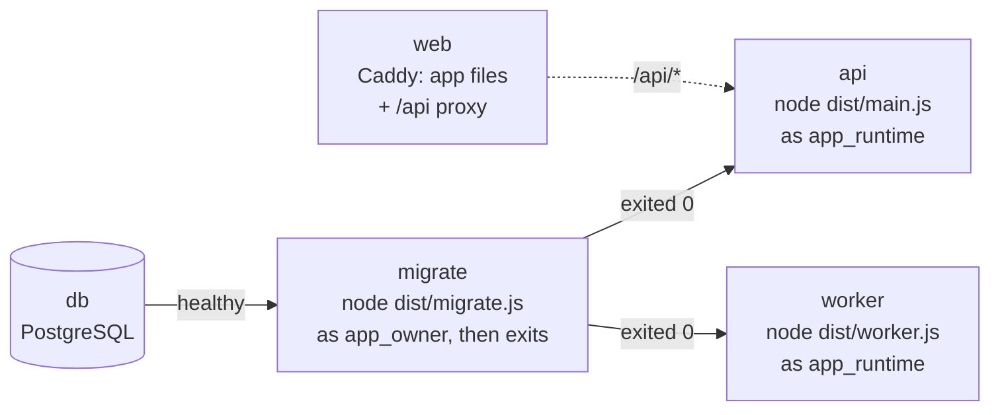
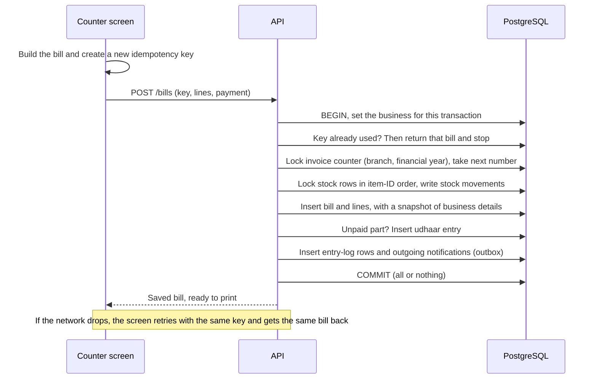

# Architecture

**Status:** Accepted 2026-10-29 (kickoff session). The reasons behind each part are in `docs/decisions/`; ADR numbers are in brackets.

## In one paragraph

A web app opened in Chrome on the shop's counter computer. It talks over HTTPS to one backend, a modular monolith [0004], running in containers on a single server on AWS Mumbai (Free plan, ₹0 budget) [0011] and storing everything in one PostgreSQL database [0005]. A worker process (same code, different entry point) runs background jobs: WhatsApp messages, alerts, PDFs [0010]. All businesses share the same tables, and the database itself keeps each business's rows apart [0006]. v1 needs internet; a dropped connection never loses or duplicates a bill [0001].

## The big picture (production)



App and API share one domain, so session cookies work and there's no CORS [0009, 0011]. Also in AWS, not drawn: SSM Parameter Store (secrets), Systems Manager (deploys without an SSH port), CloudWatch (logs, alarms), AWS Budgets (credit-usage alert). Container images live in GitHub Container Registry or ECR. Everything is created by Terraform [0011].

## Inside the backend

One NestJS app [0004]. Modules mirror the requirement files.

| Layer | Modules | Job |
| --- | --- | --- |
| Core | tenancy, auth & sessions, permissions, entry log, database & transactions | Who is asking, for which business and branch, what they may do; every write recorded |
| Domain | 00 business setup · 01 items & inventory · 02 billing · 03 udhaar · 04 suppliers · 05 staff · 06 entry-log viewer · 07 alerts · 08 dashboard · 09 AI assistant | The business rules |
| Shared code | `packages/shared`: types, Zod schemas, money and GST functions | Used by both the screen and the server [0002, 0008] |

Rules:

- A module uses another module only through that module's service, never its tables.
- Every write goes through one transaction helper that sets the current business [0006] and writes entry-log rows [0007].
- The `api` process serves HTTP. The `worker` process runs pg-boss jobs [0010]. Both come from the same image.

## Starting up: one image, three commands



- The schema is upgraded before new code runs, by the only role allowed to change it. If `migrate` fails, `api` and `worker` don't start [0021].
- `GET /api/health` answers while the process is alive (Docker's healthcheck). `GET /api/health/ready` also checks the database (503 when it can't), for deploys and Caddy later.
- On `docker stop` (SIGTERM), `api` and `worker` finish their work, close the database pool and exit 0 [0020].
- pg-boss will run in the `worker` under its own role, `app_queue`, which owns only the `pgboss` schema [0022].
- Secrets reach containers only as environment variables at start, never inside the image (`docs/devops/secrets.md`).
- `web` is its own image (Vite build served by Caddy) and starts without waiting for the API: if the API is down, the page still loads and its connection badge says so [0023].

## The web app

- One origin everywhere: the browser calls relative `/api` URLs. Vite's dev server proxies them in development; Caddy does it in Compose and on the server. So there's no CORS, no browser configuration and no `VITE_` variable [0011, 0023].
- Caching: hashed `/assets/*` files for a year, `index.html` never, so a deploy shows on the next load. Unknown paths get `index.html` (the router decides); missing assets get a 404.
- A strict Content-Security-Policy and other security headers on every response, errors included.
- Languages: English, Hindi and Hinglish (`en`, `hi`, `hi-Latn`), chosen in the header and saved in the browser until logins exist (P1.4) [0023].
- The top bar checks `/api/health/ready` every 30 s while the tab is visible, and shows connected, database down or server down [0001]. It waits up to 10 s, longer than the API's own 5 s wait for the database, so a database outage isn't mistaken for the server being down.
- Look: design tokens are CSS variables in `src/styles.css` (light on `:root`, dark on `.dark`), mapped into Tailwind with `@theme inline`; Tailwind's default colours and text sizes are removed, so screens can only use tokens. A test checks every text and edge colour against WCAG contrast in both modes. IBM Plex (Latin + Devanagari) and Lucide icons are bundled [0025].
- Layout: a sidebar (pages with their shortcut keys) and a top bar (the page's title from route `staticData`, connection, language, light/dark). Base components are shadcn/ui source in `src/components/ui/`, restyled. `/design` shows all of it, in the live app but not in the sidebar [0025].
- Light/dark: light by default; `public/theme-init.js` runs before the app and applies a saved dark theme, so there's no white flash (an external file, because the CSP blocks inline scripts) [0025].
- Shortcuts: components register them while on screen; `?` lists what works now. In text fields only F-keys, `Esc` and `Ctrl`/`Alt` combos fire (the scanner types there); letters match the physical key, so a Hindi layout works. Modals use the native `<dialog>`, because Radix Dialog injects a `<style>` the CSP blocks [0026].

## Saving a bill (the most important flow)



Why each step exists: ADR 0007 (transaction, ledger, locked counter, lock order, idempotency, snapshot), ADR 0010 (outbox), ADR 0001 (retries).

## Who can see what: four layers

1. **Business:** PostgreSQL Row-Level Security filters every query by the current business [0006].
2. **Branch:** branch-level data is filtered by the branches the user may use.
3. **Permissions:** a guard on each API route checks the per-staff feature switches (Module 00 #17). The AI assistant uses the same checks [0015].
4. **Screen:** the UI hides what a user can't use. This is convenience only. The API is the real check.

## Data-safety rules (summary)

From ADRs 0007 and 0008: no `DELETE` permission for the app's database user · append-only entry log · one transaction per business action · stock as a ledger · invoice numbers from a locked counter · idempotency keys · snapshots on bills · money in integer paise · non-destructive migrations · point-in-time restore with a monthly restore drill [0011].

## Repository layout

```
apps/
  web/              React + Vite counter app; Dockerfile + Caddyfile   [0003, 0023]
  api/              NestJS: src/main.ts (api), src/worker.ts (worker), src/migrate.ts; Dockerfile   [0004, 0020, 0021]
packages/
  shared/           types, Zod schemas, money & GST     [0002, 0008]
  db/               Drizzle schema, migrations, role bootstrap, DB integration tests   [0005, 0019]
compose.yaml        local services: db, migrate, api, worker, web   [0019, 0021, 0023]
infra/
  terraform/        AWS environments                    [0011]
.github/workflows/  CI: ci.yml, pr-title.yml            [0012, 0024]
scripts/ci/         smoke test, PR-title check          [0024]
docs/               requirements, decisions, plans, journal
```

## Environments

| Environment | Where | Database | When it runs |
| --- | --- | --- | --- |
| Local | Docker Compose on the laptop | PostgreSQL container | While developing |
| CI | GitHub Actions: five required checks (`check`, `secrets`, `migrations`, `smoke`, `pr-title`) [0024] | Testcontainers PostgreSQL for the tests, plus the Compose stack for the smoke test; both thrown away | Every pull request and every push to `main` |
| Demo (our production) | AWS, from Terraform: one EC2 server + RDS | RDS with point-in-time restore, plus a nightly copy to S3 | During the Free plan's 6 months, timed to placement season; stopped when idle to save credits |
| Staging | AWS, from the same Terraform code | Small RDS instance | Only to rehearse a risky change; destroyed the same day |

Cost guardrails: ₹0 budget on the AWS Free plan (no charges possible; up to $200 credits over 6 months). No load balancer, no NAT gateway, no ECS or EKS; EC2 and RDS stopped when idle; a credit-usage alert from day one [0011].

## Deliberately not here (yet)

| Not included | Why | Where decided |
| --- | --- | --- |
| Offline billing | Sync is where data loss happens; possible later | ADR 0001 |
| Microservices | A bill needs one transaction | ADR 0004 |
| Redis | PostgreSQL is the queue | ADR 0010 |
| Load balancer, ECS Fargate | Would use up the free credits in about 4 months; the same containers can move there later | ADR 0011 |
| Kubernetes in the cloud | ~$73/month control plane; local only (stage 11) | ADR 0011 |
| Super-admin panel | Out of v1 scope | Module 00 #24 |
| Phone app | Computers only | Module 00 #23 |
